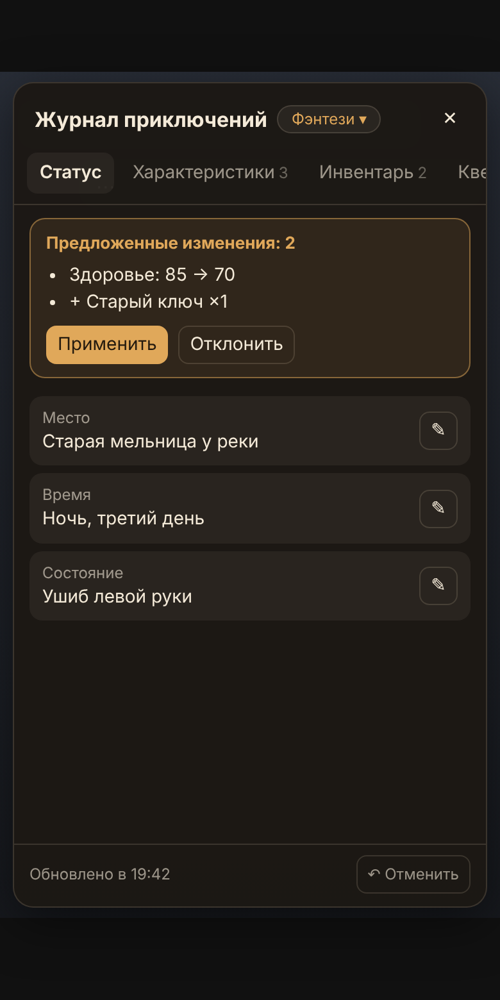

# 📜 Adventure Journal — плагин для Tavo

Журнал приключений хранит состояние ролевой игры и следит, чтобы ИИ его не забывал:

- 📍 **статус**: место, время в истории, состояние персонажа;
- 📊 **характеристики**: здоровье, мана, деньги, рассудок… или свои;
- 🎒 **инвентарь**;
- 🗺️ **квесты и цели**: активные, выполненные и проваленные;
- 💞 **отношения** со шкалой от −100 до +100.

Интерфейс на трёх языках: русский, английский, китайский (упрощённый).



## Установка

1. Скачайте [`dist/adventure-journal-1.0.0.tpg`](dist/adventure-journal-1.0.0.tpg).
2. В Tavo откройте **Ещё → Плагины → Установить → Импорт плагина из файла** и выберите файл.
3. Включите плагин. В чате должен быть включён **Advanced Rendering**.

## Как это работает

1. После ответа ИИ плагин делает один короткий дополнительный запрос к модели чата: «что изменилось?».
2. Ответ (JSON) применяется к журналу. Всё, что модель вернула не так, отбрасывается, и журнал не ломается.
3. Перед каждым следующим ответом краткая сводка журнала незаметно добавляется к вашему сообщению. Уходит она только модели, в чате её не видно.
4. Если ответ перегенерировать или отредактировать, его изменения откатываются и считываются заново. Если сообщение удалить — изменения откатываются.

## Что выбирает пользователь

| Настройка | Варианты |
|---|---|
| Шаблон жанра | Фэнтези, Научная фантастика, Романтика, Повседневность, Хоррор и детектив, Свой |
| Свой шаблон | список характеристик (`Здоровье=100/100; Монеты=10`) и подсказка, что отслеживать |
| Режим обновления | автоматически · с подтверждением (изменения сначала видны в панели) · только вручную |
| Частота | после каждых 1–5 ответов ИИ |
| Добавлять журнал в запрос | вкл/выкл (вместо этого можно вставить макрос `{{getvar::adventureJournal.summary}}` в пресет) |
| Язык записей | как в истории / язык приложения |
| Прочее | уведомления, кнопка 📜, тайм-аут, лимит токенов |

Шаблон задаётся по умолчанию для новых чатов, а для каждого чата его можно сменить отдельно (кнопка шаблона в панели или боковое меню). При смене плагин спросит, сохранить текущие записи или начать журнал заново.

## Где искать функции в Tavo

- **Кнопка 📜** в чате открывает журнал. Её можно перетаскивать, позиция запоминается. Всё внутри редактируется вручную.
- **Меню «+» → Бросить кубик**: d20, d100, 2d6 или d6, по желанию с проверкой по характеристике. Результат вставляется в поле ввода.
- **Кнопка под последним ответом** заново читает этот ответ.
- **Боковое меню чата**: открыть журнал, обновить сейчас, сменить шаблон, отменить, экспорт и импорт (перенос журнала в другой чат), очистить, сбросить позицию кнопки.

## Для разработчика

```
src/           исходники: core.js (общая логика), entry.main.js, panel.*, manifest.json
tools/         build.py (сборка и проверки), locales.py (все переводы в одной таблице)
tests/         тесты entry.js на имитации API Tavo и браузерный тест панели
dist/          готовый .tpg
```

```sh
python3 tools/build.py              # сборка + проверка ключей и лимитов длины
node --test tests/entry.test.mjs    # 17 сценариев логики
node tests/panel.preview.mjs        # панель в Chromium + скриншоты в docs/screenshots
```

`build.py` встраивает `core.js` и в `entry.js`, и в панель: модули ES в плагинах Tavo не поддерживаются, а дублировать логику не хочется. Состояние хранится в переменной чата `adventureJournal`. Панель раз в 1,5 секунды проверяет у неё счётчик `rev`, потому что HTML-фрагменты не получают события чата.

**Пока не проверено на реальном устройстве.** Тесты используют имитацию API, написанную по документации. Перед публикацией в Tavo Hub установите плагин в резервный чат и проверьте все три языка. Если подключён Tavo MCP Server, прогоните `tavo_plugin_validate_manifest → tavo_plugin_audit → tavo_plugin_package`.
